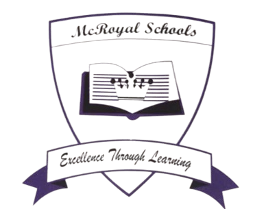
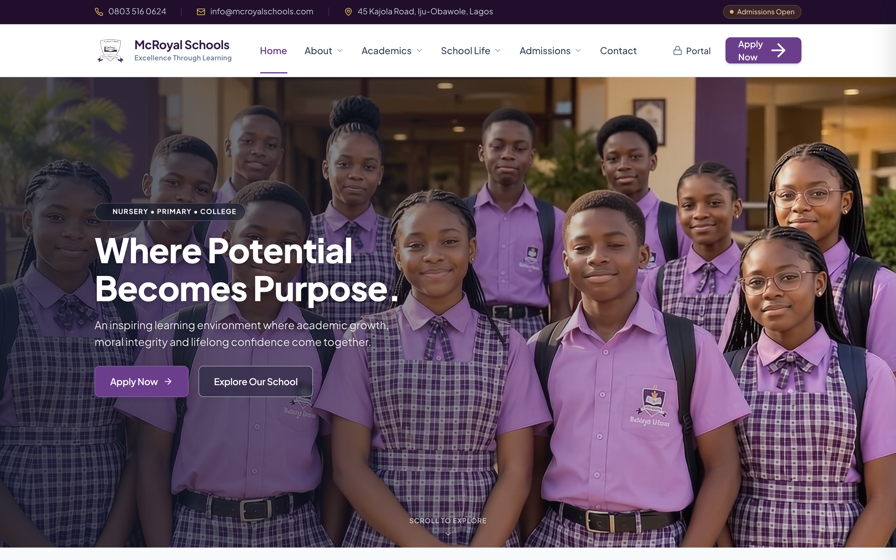
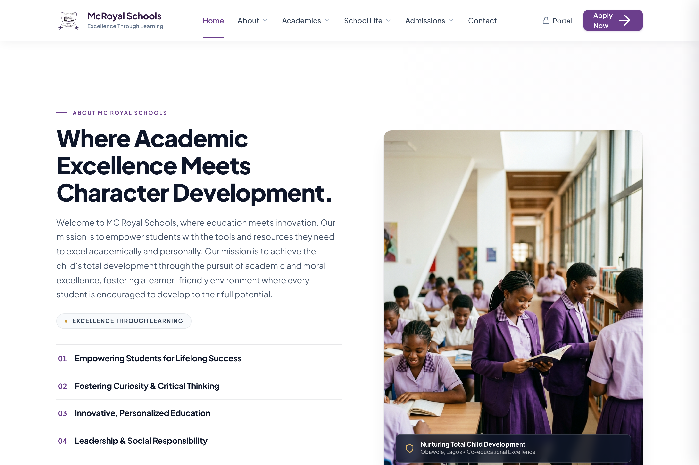
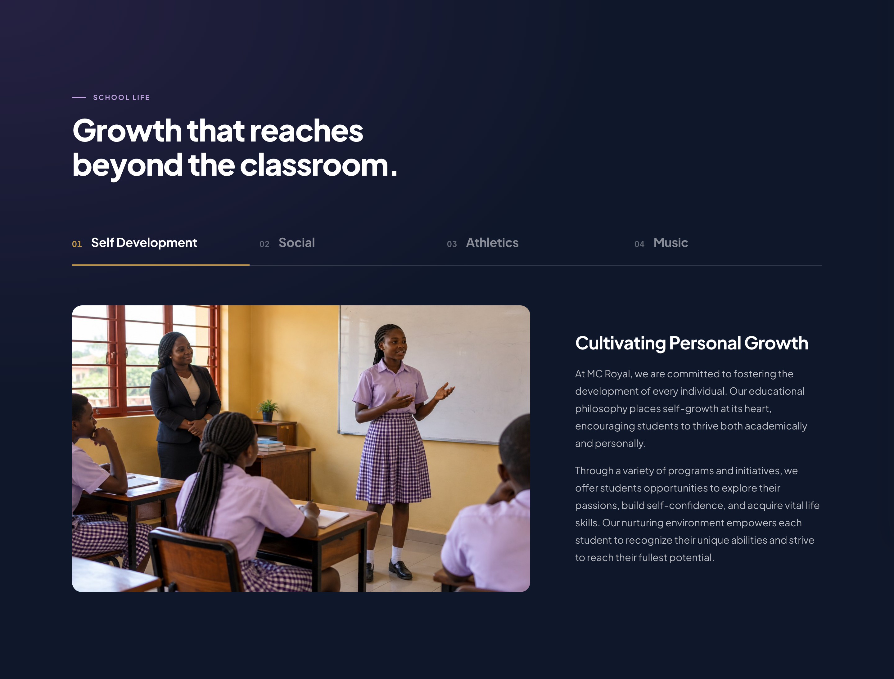
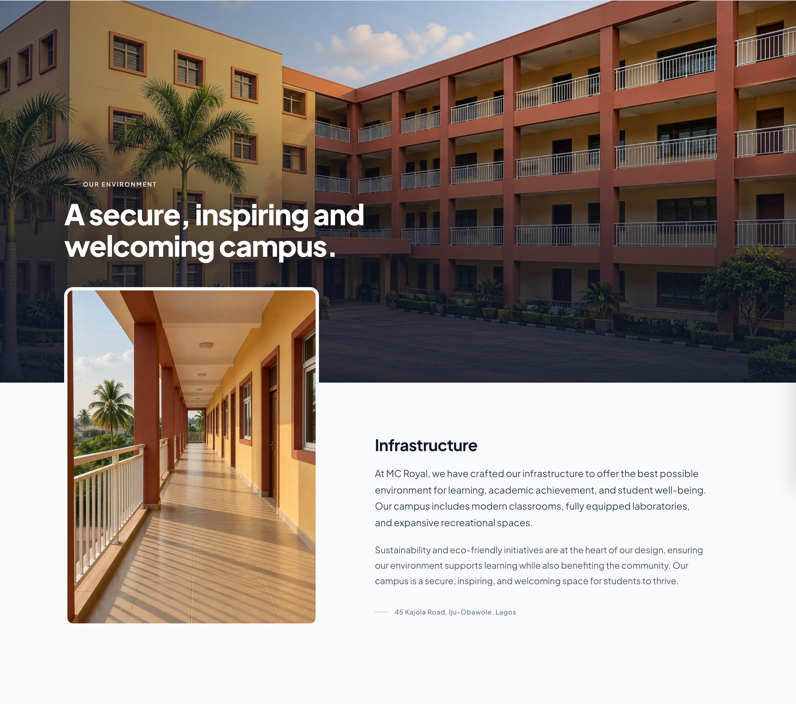
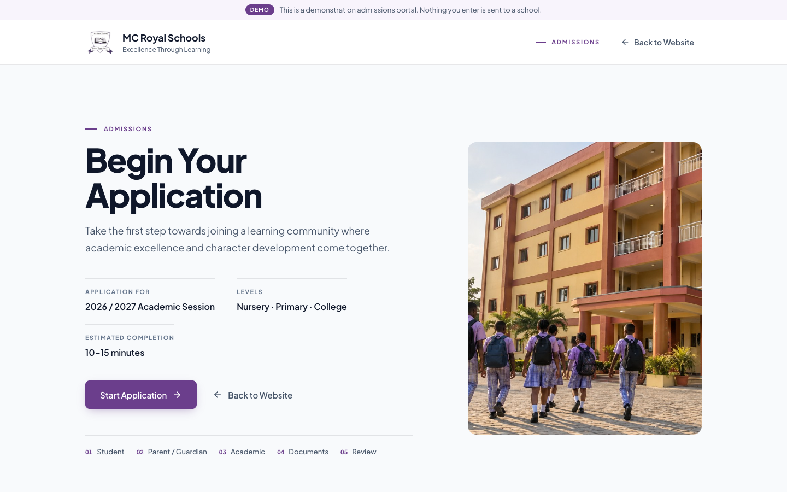

<div align="center">



# MC Royal Schools

### Premium School Website Demo

*A cinematic, premium digital experience designed for modern private schools.*

<br>

    

[**View the repository →**](https://github.com/hello2Nacho/mcroyal-premium-school-demo)

<br>



</div>

<br>

---

## ◆ Overview

A premium school website concept that shows how a school without a strong digital presence can be presented through a sophisticated, modern web experience.

The project brings together:

- cinematic video and premium photography
- editorial typography and generous whitespace
- responsive layouts, built for every screen size
- institutional storytelling drawn from the school's own content
- school information, admissions and a demo application portal

---

## ◆ The Experience

| | |
|---|---|
| 🎬 **Cinematic Hero** | Full-viewport video with a quiet, confident headline |
| 📚 **How We Learn** | The school's five educational principles, set editorially |
| 🏫 **About MC Royal** | Mission, philosophy and institutional pillars |
| 🎓 **Academics** | Curriculum, Secondary College, Primary & Kindergarten |
| 🌱 **School Life** | Personal growth, social life, athletics, music and campus |
| 📝 **Admissions** | An invitation to apply, with the school's admission principles |
| 💻 **Admissions Portal** | A five-step demo application, from student details to review |
| ✉️ **Newsletter** | A front-end sign-up interaction |
| 🔗 **Institutional Footer** | Contact details, links and the school motto |

<br>

<table>
  <tr>
    <td width="50%"></td>
    <td width="50%"></td>
  </tr>
  <tr>
    <td width="50%"></td>
    <td width="50%"></td>
  </tr>
</table>

---

## ◆ Design Philosophy

> **Premium, not template-like. Editorial, not SaaS-like.**

- **Authentic content.** The school's own words, structure and claims, presented better. Nothing invented.
- **Whitespace as structure.** Every section is given room to breathe.
- **Restrained colour.** Royal purple for intent, gold used almost never.
- **Human photography.** Students and campus come first, not stock imagery.
- **Responsive by design.** Each breakpoint is composed, not shrunk.
- **Accessible by default.** Keyboard navigation, visible focus and proper labels.
- **Subtle motion.** Gentle reveals, never spectacle, and reduced-motion support throughout.

---

## ◆ Key Features

| | |
|---|---|
| 🎥 Full-viewport cinematic hero video | 🧭 Responsive header with dropdown navigation |
| ↕️ Smooth in-page section navigation | 📱 Slide-out mobile navigation |
| 🖼️ Premium, edge-to-edge image treatment | 📚 Educational philosophy section |
| 📝 Admissions section | 💻 Demo admissions portal |
| ✉️ Newsletter interaction | 🌗 Reduced-motion support |
| ♿ Accessibility considerations | 🔒 No external school-site dependencies |

---

## ◆ Responsive Experience

Designed and tested at five widths:

<div align="center">

`1440px` · `1366px` · `1024px` · `768px` · `390px`

</div>

- No horizontal overflow at any width
- Navigation that adapts from full menu to mobile drawer
- Touch-friendly controls on small screens
- Image and video compositions re-framed for each layout

---

## ◆ Technology

      

Hand-written HTML, CSS and vanilla JavaScript: no framework and no build step. Typography uses **Plus Jakarta Sans**. Development screenshots and QA checks are scripted with Puppeteer.

---

## ◆ Project Structure

```
mcroyal-premium-school-demo/
├── index.html              Homepage
├── admissions/
│   └── index.html          Demo admissions portal
├── assets/
│   ├── images/             Logo and photography
│   └── videos/             Hero video
├── css/
│   ├── tokens.css          Design tokens: colour, type, spacing
│   └── components/         One stylesheet per section
├── js/
│   ├── school-config.js    School identity for the portal
│   └── …                   Navigation, portal and demo behaviour
├── scripts/                Screenshot and QA scripts
├── screenshots/            Captures at each breakpoint
└── package.json
```

---

## ◆ Demo Admissions Portal

Rather than sending visitors to the school's real external portal, every **Apply** button opens a custom admissions experience at `/admissions`:

**Student** → **Parent / Guardian** → **Academic** → **Documents** → **Review** → **Received**

It includes inline validation, document attachment, a review step with editing, and a demo application reference. Progress is saved in the browser.

It demonstrates how the school could eventually handle online applications. **Nothing is submitted, uploaded or emailed.**

---

## ◆ Design System

| Colour | Name | Hex |
|:---:|---|---|
|  | Royal Purple | `#6B3E8C` |
|  | Heritage Violet | `#8663A6` |
|  | Soft Lavender | `#F8F4FC` |
|  | Regal Gold | `#C99738` |
|  | Deep Slate | `#0F172A` |

---

## ◆ Project Status

```
✓  Homepage complete
✓  Responsive layouts
✓  Navigation implemented
✓  Admissions experience implemented
✓  Demo portal implemented
✓  GitHub repository established
```

---

## ◆ Run Locally

The site is static. Serve the folder so `/admissions` resolves:

```bash
python3 -m http.server 3000
```

Then open [http://localhost:3000](http://localhost:3000).

---

> [!NOTE]
> **About this demo.** MC Royal Schools is the reference school used for this demonstration. This is not the school's production website. The design approach and architecture can be adapted into personalised demo websites for other schools.

---

## ◆ Future Direction

Possible extensions, none of which exist yet:

- Content management for school staff
- A real admissions backend
- A parent and student portal
- Newsletter service integration
- Privacy-respecting analytics
- Additional institutional pages

---

<div align="center">

<br>

*Designed to show what a school can look like when its digital presence is treated as an institution — not just a website.*

<br>

<sub>Built with care for premium educational digital experiences.</sub>

<br><br>

</div>
